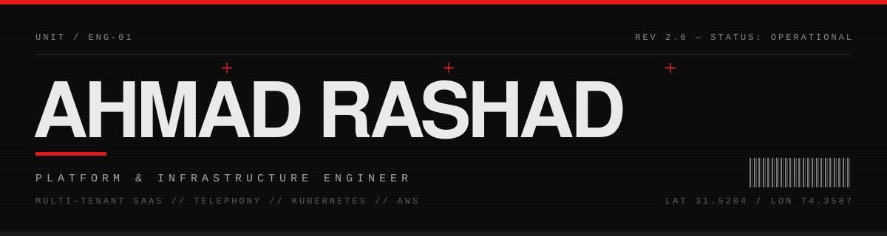

```
╔══════════════════════════════════════════════════════════════════════════════╗
║  [ 00 / IDENT ]                                          CHANNELS — OPEN     ║
╚══════════════════════════════════════════════════════════════════════════════╝
```

[](https://linkedin.com/in/ahmadrashad1)
[](mailto:ahmadrashad1@gmail.com)
[](https://github.com/ahmadrashad1)


```
╔══════════════════════════════════════════════════════════════════════════════╗
║  [ 01 / SUBJECT ]                                                            ║
╚══════════════════════════════════════════════════════════════════════════════╝
```

> I build the unglamorous parts: the systems that have to keep working at 3am,
> when nobody is watching and the thing has already been deployed.

```
  DESIGNATION ─── Platform & Infrastructure Engineer
  BASE ────────── Lahore, Pakistan
  ACADEMIC ────── Computer Science — FAST NUCES
  DOMAIN ──────── Multi-tenant SaaS · Real-time telephony · Browser automation
  POSTURE ─────── Production first. Tests before claims. Honest status over green ticks.
```

```
╔══════════════════════════════════════════════════════════════════════════════╗
║  [ 02 / SYSTEMS BUILT ]                                                      ║
╚══════════════════════════════════════════════════════════════════════════════╝
```

```
┌──────────────────────────────────────────────────────────────────────────────┐
│ ▓▓  MULTI-TENANT SAAS PLATFORM                                   OPERATIONAL │
│     Row-level tenant isolation, role/permission engine, audit evidence,      │
│     invitation + self-serve onboarding, zero-downtime migrations.            │
│     NestJS · React Router · PostgreSQL/RLS · Supabase                        │
├──────────────────────────────────────────────────────────────────────────────┤
│ ▓▓  PREDICTIVE DIALING & TELEPHONY                               OPERATIONAL │
│     Carrier trunking, call state machines, agent handsets in the browser,    │
│     pacing, DID rotation, and compliance windows enforced per lead timezone. │
│     Elixir/Phoenix · FreeSWITCH · SIP · WebRTC                               │
├──────────────────────────────────────────────────────────────────────────────┤
│ ▓▓  BROWSER-AUTOMATION FLEET                                     OPERATIONAL │
│     One isolated pod per account, residential egress, session safety, warm-  │
│     up schedules, health rules that stop the machine before a human must.    │
│     Kubernetes · Playwright · Redis · BullMQ                                 │
├──────────────────────────────────────────────────────────────────────────────┤
│ ▓▓  CROSS-SYSTEM INTEGRATION                                     OPERATIONAL │
│     Signed webhooks, idempotent replay, event contracts with versioned       │
│     envelopes, suppression that holds across every channel at once.          │
│     AWS ECS · k3s · GitHub Actions · Terraform-adjacent IaC                  │
└──────────────────────────────────────────────────────────────────────────────┘
```

```
╔══════════════════════════════════════════════════════════════════════════════╗
║  [ 03 / STACK ]                                                              ║
╚══════════════════════════════════════════════════════════════════════════════╝
```

**`LANGUAGES`**


**`RUNTIME / FRAMEWORK`**


**`INFRASTRUCTURE`**


```
╔══════════════════════════════════════════════════════════════════════════════╗
║  [ 04 / TELEMETRY ]                                                          ║
╚══════════════════════════════════════════════════════════════════════════════╝
```


```
╔══════════════════════════════════════════════════════════════════════════════╗
║  [ 05 / INDEX — RECENTLY STARRED ]                      AUTO / DAILY SWEEP   ║
╚══════════════════════════════════════════════════════════════════════════════╝
```

<!-- STARRED:START -->
```
┌──────────────────────────────────────────────────────────────────────────────┐
│ ▓ ahmadrashad1/padel-3dwebsite-forked                        TypeScript  ★ 1 │
│   no description                                                             │
├──────────────────────────────────────────────────────────────────────────────┤
│ ▓ ahmadrashad1/GASR--Research                              Jupyter Not…  ★ 1 │
│   no description                                                             │
├──────────────────────────────────────────────────────────────────────────────┤
│ ▓ ahmadrashad1/3D-coffee-website-forked                      TypeScript  ★ 1 │
│   no description                                                             │
├──────────────────────────────────────────────────────────────────────────────┤
│ ▓ ahmadrashad1/AI-Finance-Assistant                              Python  ★ 1 │
│   no description                                                             │
├──────────────────────────────────────────────────────────────────────────────┤
│ ▓ ahmadrashad1/Vehice-Tracking-System-B…                           Java  ★ 1 │
│   no description                                                             │
├──────────────────────────────────────────────────────────────────────────────┤
│ ▓ ahmadrashad1/vehicle-tracking-3.0-ui                       TypeScript  ★ 1 │
│   no description                                                             │
└──────────────────────────────────────────────────────────────────────────────┘
```
<!-- STARRED:END -->

```
──────────────────────────────────────────────────────────────────────────────
  © AHMAD RASHAD ®         BUILT TO RUN UNATTENDED         EOF / UNIT ENG-01
──────────────────────────────────────────────────────────────────────────────
```
